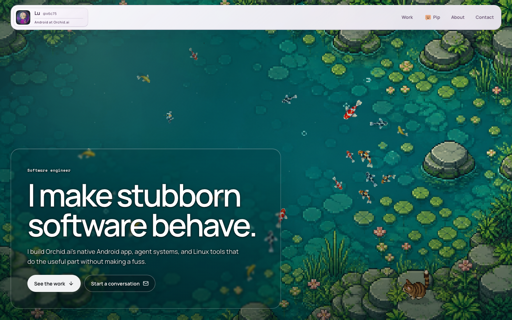
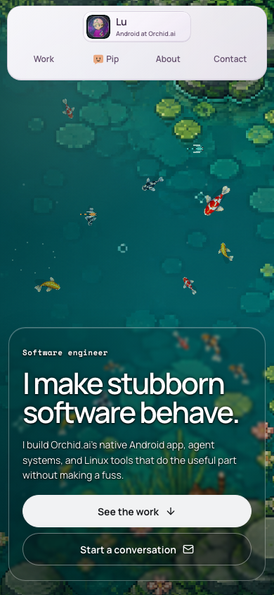
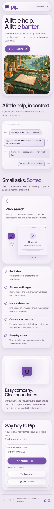
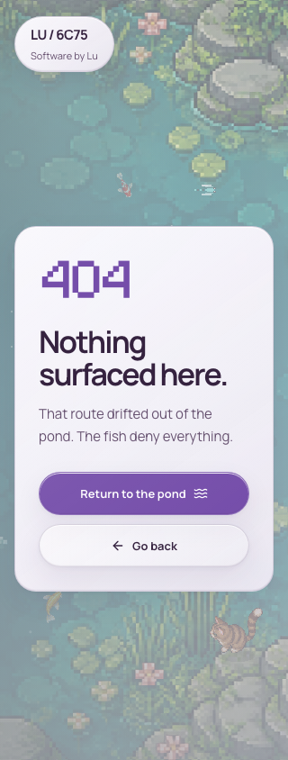

# Site optimization and security pass

Reviewed the homepage, Pip, authored 404 and retired routes, animation lifecycle,
static export, local preview server, dependencies, and Pages workflows. The base
was `11793aff78fca868bce3fb2c1148c5bc4ba493d9`.

## Results

Each page now loads its own entry and styles. Vite owns stylesheet and preload
generation. The server retains the route registry and prerendered HTML. Pond and
Pip renderers remain deferred, with their existing artwork, gestures, fallback,
visibility, and reduced-motion behavior.

| Page | Initial JS before | Initial JS after | CSS before | CSS after |
| --- | ---: | ---: | ---: | ---: |
| Home | 433,530 B | 410,760 B | 83,654 B | 59,135 B |
| Pip | 433,530 B | 276,864 B | 83,654 B | 40,855 B |
| 404 | 433,530 B | 260,720 B | 83,654 B | 26,121 B |

These are deduplicated, uncompressed bytes declared by the built HTML through
scripts, module preloads, and stylesheet links. They exclude images, fonts, and
deferred renderers. They are not page-load timings or total transfer sizes.
Pip's 36.1% reduction was also confirmed in browser resource entries. A regression
check requires its initial scripts to remain below 300,000 bytes.

Reproduce the report after `npm run build` with
`node scripts/measure-page-assets.mjs`. See [before](assets-before.json),
[after](assets-final.json), and [browser evidence](qr-decode.json).

The Pip typing animation also avoids writing unchanged text before its geometry
reads. Pond seeds are bounded to 128 characters and written to the diagnostic
attribute once. The copyright year comes from the build so a visitor's clock
cannot cause a year-related hydration mismatch.

## Security changes

- Generate Pip's QR SVG during development setup and builds. It loads from this
  site only after Show QR. Independent decoding returned
  `https://t.me/PIPSOFTWARE_BOT`. Copy, clipboard failure, and QR failure behavior
  remain covered.
- Add a production HTML Content Security Policy that blocks inline scripts and
  external connections. Browser probes verify the exported meta policy with the
  preview server's CSP header removed. React's inline styles and local blob/data
  images remain allowed.
- Resolve preview files to canonical paths before reading them. A synthetic
  symlink served an outside sentinel before the fix and returns 403 after it.
  Malformed paths, unsupported methods, HEAD, aliases, and nested 404s are covered.
- Restrict Pages write and identity-token permissions to deployment. The build
  receives contents/read and pages/read for configuration lookup. Pin action
  commits and disable persisted checkout credentials. Add PR checks for auditing,
  lint, unit tests, and the production browser suite.

The [dependency audit](audit-final.json) reported zero known vulnerabilities.
Source review found no executable user-controlled HTML sink or exposed credential
in the inspected site paths. This does not establish the absence of every flaw.

The preview sends additional HTTP protections. Production response headers are
controlled by GitHub Pages and Cloudflare. Public frame-embedding restrictions
remain a hosting-layer action because
[frame-ancestors does not work in a meta policy](https://developer.mozilla.org/en-US/docs/Web/HTTP/Reference/Headers/Content-Security-Policy/frame-ancestors).
No host configuration or deployment was changed. Pages read permission follows
the [Pages API requirement](https://docs.github.com/en/rest/pages/pages#get-a-github-pages-site).

## Verification and review

The [final combined browser run](browser-verified.log) passed all 38 tests in
298.989 seconds. Other completed checks include type checking, lint, production
build, [33 pond tests](pond-after.log), 3 Pip contact tests, actionlint, dependency
audit, independent QR decode, and [four security-boundary tests](security-meta-final.log).
Chromium covers desktop, 320px and
390px layouts, keyboard navigation, no-JavaScript content, reduced motion, WebGL
fallbacks, route metadata, and animation interactions.

The baseline browser run was interrupted and is only partial evidence. An earlier
combined run exposed CSP-incompatible test polling. Polling now uses browser
evaluation without adding unsafe-eval. A later run exposed two separate test taps
arriving 470 ms apart, beyond the existing 430 ms gesture window. Chromium now
schedules that double tap as one trusted input gesture. Application gesture
timings were not changed.

The final passing run includes the strict exported policy probe and the corrected
touch input. It supersedes the earlier failed runs and the pending-runtime note
in Review A.

[Review B](review-b.txt) found development SPA fallback routing `/missing.html`
to Home. The fix uses MPA mode and a handler after static assets. A browser
regression verifies unknown dotted paths and real asset requests.
[Review A](review-a.txt) found no further actionable source issues. The first
attempt at Review A failed model capacity; the retry completed. Both completed
reviewers used GPT-6.1-Sol at different reasoning levels. Other model families
were unavailable under the configured policy.

The [design judgment](design-review.txt) selected native page entries over custom
manifest traversal. The [decision trail](decisions.tsv) records choices, failed
checks, corrections, and evidence. No active transcript artifact was exposed for
a transcript-to-log audit. Review B spot-checked artifact claims and identified a
weak design evidence pointer, which the trail supersedes.

## Visual acceptance and remaining limits

PASS for inspected Chromium views. The homepage retains its pond, readable hero,
navigation, and project content. Pip retains its layout and automatic demo. The
404 remains readable at 320px. Production pages retain styled content without
JavaScript. Screenshots below show the reviewed artifact.

Physical iPad Safari, Firefox, screen readers, and live bot replies were not
tested. Development without JavaScript retains the pre-existing unstyled SSR
behavior; use the production preview for no-JavaScript visual verification.

The seven pond source assets still total about 5.7 MB. Re-encoding the authored
textures, removing the 404 pond, changing reduced-motion animation, and gating
all diagnostic writes were deferred. Those changes need separate visual or
profiling evidence. This pass makes no FPS or device-performance claim.

Boundary Discipline put checks at URL and filesystem inputs. Laziness Protocol
favored Vite's native page entries. Prove It Works required browser enforcement,
decoded QR output, and measured built assets rather than source-only claims.

